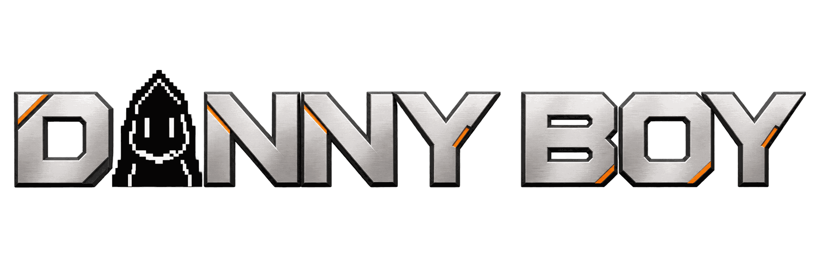

# DonnyBoy pro Android



**Českej parťák pro Flipper Zero.**

DonnyBoy upravuju pro svůj firmware [DONNY BOY CZ](https://github.com/luciferbelzebob3-afk/DONNYBOYCZ). Chtěl jsem mít ovládání Flipperu, soubory a přehled novejch verzí na jednom místě — v češtině a ve vzhledu, kterej k Donny Boyovi patří.

Černý pozadí, oranžový detaily a náš kluk v kapuci. Žádnej účet navíc, žádný předplatný.

## Co v aplikaci najdeš

- Připojení k Flipperu přes Bluetooth nebo USB.
- Správu souborů, archiv a vzdálený ovládání převzatý z qUnleashed.
- Nabídku vydání firmwaru DONNY BOY CZ.
- České rozhraní, který je při nový instalaci nastavený rovnou.
- Volitelný upozornění na nový stabilní verze firmwaru.
- Tlačítka **REPO**, **WEB** a **INFO**, abys měl důležitý odkazy po ruce.

## Stažení a instalace

APK najdeš v [Releases](https://github.com/luciferbelzebob3-afk/DONNYBOYCZAPK/releases). Potřebuješ **Android 10 nebo novější**.

Stáhni APK, otevři ho v telefonu a případně povol instalaci z prohlížeče nebo správce souborů, kterej používáš. Oprávnění pro připojení a oznámení si nastavíš podle toho, co chceš používat.

Verze **1.0.0** přináší nový logo, vlastní ikonu a vlastní podpis aplikace. Jestli máš nainstalovaný starý preview, Android může kvůli odlišnýmu podpisu vyžadovat jeho odinstalování. Tím se smažou místní data aplikace.

Připojení BLE/USB a aktualizaci firmwaru zatím nemám ověřený na fyzickým zařízení. Pokud narazíš na chybu, napiš do [Issues](https://github.com/luciferbelzebob3-afk/DONNYBOYCZAPK/issues) a přidej model telefonu, verzi Androidu a postup, jak ji zopakovat.

## Upozornění na novej firmware

Na úvodní obrazovce klepni na **Zapnout oznámení** a povol je v Androidu. Aplikace pak na pozadí kontroluje nový stabilní vydání DONNY BOY CZ.

První kontrola si zapamatuje aktuální verzi. Upozornění přijde až na další vydání. Kontroly plánuje Android přibližně po 15 minutách; úspora baterie je může odložit. Nejde tedy o okamžitý push oznámení. Sledování můžeš kdykoliv vypnout přímo v aplikaci.

## Vlastní sestavení

Vyvíjím ve větvi `dev`. Projekt používá Flutter **3.47.1** a Javu **17**.

```sh
git clone --branch dev --recurse-submodules https://github.com/luciferbelzebob3-afk/DONNYBOYCZAPK.git
cd DONNYBOYCZAPK
flutter pub get --enforce-lockfile
flutter analyze --no-pub
flutter test --no-pub test/donnyboy_test.dart
flutter build apk --release --build-name=1.0.0 --build-number=100001
```

Pro vlastní release podpis nastav `android/key.properties`. Bez něj používá místní sestavení vývojovej podpis. Podrobnosti jsou v [dokumentaci podepisování](docs/donnyboy-signing.md).

## Původ projektu

DonnyBoy vychází z [qUnleashed](https://github.com/DarkFlippers/qUnleashed). Na původní práci navazuju českým překladem, vlastním vzhledem a propojením s DONNY BOY CZ. Původní autoři zůstávají uvedený a projekt zachovává licenci [GPL-3.0](LICENSE).

Pokud se ti aplikace nebo firmware líbí, podpoř taky [vývojáře Unleashed](https://flipperunleashed.com/), bez kterejch by tenhle základ nevznikl.

[DONNY BOY CZ — firmware](https://github.com/luciferbelzebob3-afk/DONNYBOYCZ) · [Web projektu](https://luciferbelzebob3-afk.github.io/DONNYBOYCZ/)

**NQLSH**
